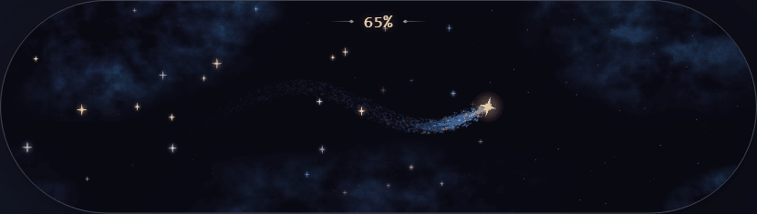

# 加载动画

两个可离线运行的 Canvas 加载动画。下载仓库并解压，用浏览器打开对应的 HTML 文件即可。

| 动画 | 本地入口 | 交互 |
| --- | --- | --- |
| 星迹 | `outputs/starlight.html` | 流星沿波浪航迹逐颗点亮星星。拖动滑块可停在任意进度，观察星光闪烁、流星摆动和星雾淡入淡出。 |
| 森林生长 | `outputs/index.html` | 园丁边走边浇水，树木和野花在身后生长。点击园丁可让他跳起，进度到达 100% 时全景开花。 |

两个页面都支持播放、暂停和重播。星迹是独立 HTML 文件。单独复制森林版本时，请将 `forest.js` 与 `index.html` 放在同一目录。

## 星迹预览

下图固定在 65% 进度，展示星雾和星光的 18 秒循环。

